# APilot: AI-powered Accounts Payable decisions

APilot turns vendor invoice PDFs (digital or scanned) into validated, explainable decisions:
**APPROVE · REVIEW · REJECT · DUPLICATE**. Every decision comes with a structured trace (checks performed, passed,
failed, skipped), the money at risk, and the recommended next action.

**Design principle: AI reads, rules decide.** OCR and an optional LLM turn documents into structured data.
Deterministic Python rules make every financial decision. No LLM is used for decisions or explanations.

---

## 1. Setup and run (local)

Requirements: Python 3.10+ and the Tesseract OCR engine.

```bash
# Tesseract (system program, not a pip package)
#   Windows: install from https://github.com/UB-Mannheim/tesseract/wiki and add its folder to PATH
#   macOS:   brew install tesseract
#   Linux:   sudo apt install tesseract-ocr
tesseract --version                      # must print a version

pip install -r requirements.txt

python test_pipeline.py                  # 14 demo scenarios (13 original + 1 added) -> expect 14/14
python -m unittest discover -s tests -t . -v   # 36 unit, workflow and UI tests -> expect OK

streamlit run app.py                     # opens http://localhost:8501
```

`apilot.db` (SQLite) is created next to `app.py` on first run. To use another location, set `APILOT_DB=/path/file.db`.
To regenerate demo data: `python generate_test_data.py` (existing sample PDFs are kept; `--overwrite` re-renders all).

**Optional Gemini extraction:** set `GEMINI_API_KEY` (free key from Google AI Studio) and optionally `GEMINI_MODEL`
(default `gemini-2.5-flash`). Without a key, everything runs locally. If the Gemini call fails, processing continues
with the local rules.

### Deploy (free): Streamlit Community Cloud
See **DEPLOY.md** for the exact click-by-click steps. In short: public GitHub repo with `app.py` at the root,
then share.streamlit.io → Create app → branch `main`, file `app.py`, Python **3.12** (Advanced settings).
`packages.txt` installs Tesseract; `requirements.txt` is pinned to the versions the tests passed on.
Storage on Community Cloud is temporary and shared by all visitors (see DEPLOY.md, "Limitations").

---

## 2. Architecture

```mermaid
flowchart LR
  A[Invoice PDF] --> B[Intake: PDF check + SHA-256]
  B --> C{Text layer?}
  C -- yes --> D[PyMuPDF text]
  C -- no / scanned --> E[Tesseract OCR + word confidence]
  D --> F[Rule parser]
  E --> F
  D -. optional .-> G[Gemini]
  E -. optional .-> G
  F --> H[Merge + field confidence]
  G --> H
  H --> I[Arithmetic corroboration]
  I --> J[Mandatory fields]
  J --> K[Vendor: exists, active, GSTIN, bank]
  K --> L[Duplicates]
  L --> M[PO match: price tolerance, cumulative qty, GRN, PO balance]
  M --> N[Financial: line math, subtotal, GST regime + amounts, total]
  N --> O[Decision engine + trace]
  O --> P[(SQLite: invoice + lines + audit, one transaction)]
  P --> Q[Review queue: re-validate, approve / reject / audited override]
  P --> R[Dashboard / Explorer / Audit trail]
```



Any unexpected error in a stage stops automation, marks the remaining stages *skipped*, and produces **REVIEW**.
An invoice is never approved after an error.

| File | Purpose |
|---|---|
| `config.py` | Tolerances, thresholds, GST rate, GRN policy, override policy, AI settings |
| `extraction.py` | PDF intake, text layer, OCR, rule parser, Gemini call, merge + confidence |
| `rules.py` | Business rules, GST validation, decision engine + trace, review re-validation |
| `pipeline.py` | Runs stages, streams events to the UI, stops on critical errors, reports save failures |
| `review.py` | Human approve/reject with re-validation and audited overrides |
| `db.py` | SQLite: invoices, billed lines (PO consumption), append-only audit log |
| `master_data.py` | Vendor master, POs, goods receipts (CSV stand-ins for an ERP) |
| `gstin.py` | GSTIN format + checksum |
| `app.py` | Streamlit UI |
| `generate_test_data.py` | Synthetic master data + invoice PDFs |
| `test_pipeline.py` | Scenario test (original 13 + added) |
| `tests/` | `unittest` suites: GST, workflow, UI (AppTest) |

---

## 3. Decision rules

Order matters. The first matching rule decides.

1. **DUPLICATE**: the same file, or the same vendor plus the same normalised invoice number (`INV-NOS-1042` = `INV/NOS/1042`), matches an invoice that is **approved or pending review**.
2. **REJECT**: a confirmed violation. This means an unknown or inactive vendor, a closed PO, a PO issued to another vendor, a PO line already fully billed, a PO fully billed, or an unreadable file.
   - *Safety valve:* if the rejection relies on low-confidence extracted data, the result becomes REVIEW instead.
3. **REVIEW**: missing or low-confidence fields, a price above tolerance, quantity above what was ordered or received, a missing GRN (when mandatory), GST errors, arithmetic errors, an inferred PO, changed bank details, a fuzzy near-duplicate, or a system error.
4. **APPROVE**: nothing above applies.

**Duplicate policy:** invoices that are approved or pending review count. Rejected invoices (by the system or a reviewer) and DUPLICATE records do not, so a corrected resubmission, or the same file sent again after a rejection, is processed fresh. Earlier records and their audit history are kept. Fuzzy matches (same vendor and amount, with a similar number or the same date) always produce REVIEW, never automatic rejection.

**GST** (`rules.validate_gst`):
- Same state as the buyer: CGST and SGST must both be present, each half the rate, equal to each other, with no IGST.
- Different state: IGST at the full rate, with no CGST or SGST.
- Total tax must equal the configured rate. Rounding tolerance is ₹1.
- Unknown vendor: the regime check is SKIPPED.

**Goods receipt (3-way match):**
- `GRN_REQUIRED=True` (default): a missing GRN produces REVIEW.
- `False`: the check is reported as SKIP.
- A 3-way pass is only reported when a GRN exists and covers the cumulative billed quantity.

**Human review:** approval re-checks, against current data, the PO status, cumulative quantities against ordered and received, the PO value balance, and any duplicate approved meanwhile.
- *Conflicts* (for example, another invoice used up the PO meanwhile) need an explicit override: a checkbox, a reason of at least 15 characters, and the reviewer's name. All of it is stored in the audit trail.
- *Blocking conflicts* (a duplicate already approved, a closed PO) cannot be overridden.
- A guarded update prevents two reviewers from deciding the same invoice.

---

## 4. Demo scenarios (`samples/`, run in this order on a fresh database)

| File | Expected |
|---|---|
| 01 happy path (Nimbus) | APPROVE: 3-way match passes for all lines |
| 02 same invoice re-sent as `INV/NOS/1042`, other layout | DUPLICATE |
| 01 again (same file) | DUPLICATE |
| 03 poor-quality scan (Kaveri) | REVIEW: number/date/PO unreadable (left empty), PO inferred, amounts verified by arithmetic |
| 04a, 04b split billing on PO-2026-0104 | APPROVE (partial), APPROVE (completes PO) |
| 04c third invoice after PO used up | REJECT |
| 05 unit price +10% vs PO | REVIEW: overcharge ₹12,000 before tax |
| 06 bank account changed | REVIEW (fraud signal) |
| 07 inactive vendor, closed PO | REJECT |
| 08 no PO number | REVIEW: PO inferred |
| 09 corrupted file | REJECT (unreadable) |
| 10 unknown vendor | REJECT |
| 11 goods not receipted (added) | REVIEW: no GRN |

---

## 5. What is implemented, tested, verified, and not tested

**Automated tests in this repository (all executed, all passing at packaging time):**

`test_pipeline.py` covers 14 scenarios: the original 13, unchanged, plus `11_missing_grn`.

`tests/test_gst.py` has 12 tests:
- correct CGST + SGST; missing CGST; missing SGST
- unequal CGST/SGST (even when the total is right)
- correct IGST; incorrect IGST; missing IGST
- IGST charged on an intra-state supply; CGST/SGST charged on an inter-state supply
- unknown vendor (regime skipped); configurable rate; rounding tolerance

`tests/test_workflow.py` has 20 tests:
- **GRN:** missing GRN when mandatory gives REVIEW; when optional it gives SKIP, never a pass; real 3-way pass on the happy path
- **GST end to end:** generated PDFs with wrong GST
- **Critical-stage failure:** stops processing, skips later stages, gives REVIEW, and keeps the stack trace in the record. Failures in 4 different stages all avoid APPROVE.
- **Database failure:** not reported as saved, no phantom history, downloadable report
- **Atomic save:** a failed audit insert leaves no invoice row
- **Duplicate policy:** reprocessing a rejected invoice, resubmitting after a reviewer rejection, a pending invoice counting as duplicate, normalised-number duplicates, fuzzy match giving REVIEW
- **Review:** PO used up while an invoice waited in review; override rules; override audit details; clean approval; double-approval guard; required fields; a duplicate approved meanwhile blocks approval
- **Restart:** history read back by a separate Python process

`tests/test_app.py` has 4 Streamlit AppTest tests:
- every page renders with an empty and a populated database
- the happy path processed through the UI
- a database failure shown with the "NOT saved" warning
- a review override completed through the UI

**Manually verified:** the Streamlit server boots and passes its health check (`/_stcore/health`). AppTest runs the real script, but **no browser screenshots or visual-layout review** were done.

**Not tested:**
- A **live Gemini API call**. The test environment cannot reach Google. The failure fallback is covered by a test, but the success path is not.
- Deployment on Streamlit Community Cloud.
- Tesseract on Windows or macOS. Tests ran on Linux with Tesseract 5.3.

**Not measured:** extraction accuracy on real-world invoices. The rule parser is tuned to common Indian GST layouts, and unfamiliar layouts depend on Gemini or a human. No accuracy or time-saving figures are claimed.

---

## 6. Demo assumptions and production limitations

**Demo assumptions:**
- Buyer: Acme Retail India Pvt Ltd, Karnataka (state code 29). Currency INR. Dates are day-first.
- **18% GST on every line.** This is a demo assumption, not a universal rate. Real rates depend on HSN/SAC codes and would come from an item master. It can be changed with `APILOT_GST_RATE`.
- Master data comes from CSV files standing in for an ERP. PO consumption counts approved invoices only; pending invoices are shown but not reserved, and re-validation at approval time covers that gap.

**Production limitations and next steps:**
- No authentication or role-based approval limits. The reviewer name is self-declared.
- SQLite is single-node. Use Postgres or Supabase for multi-user deployments.
- There is no email intake, ERP write-back or payment-run integration yet.
- Multi-currency, non-PO invoices, credit notes, and per-line GST rates are not handled.
- Reviewer corrections are not fed back to improve extraction.
